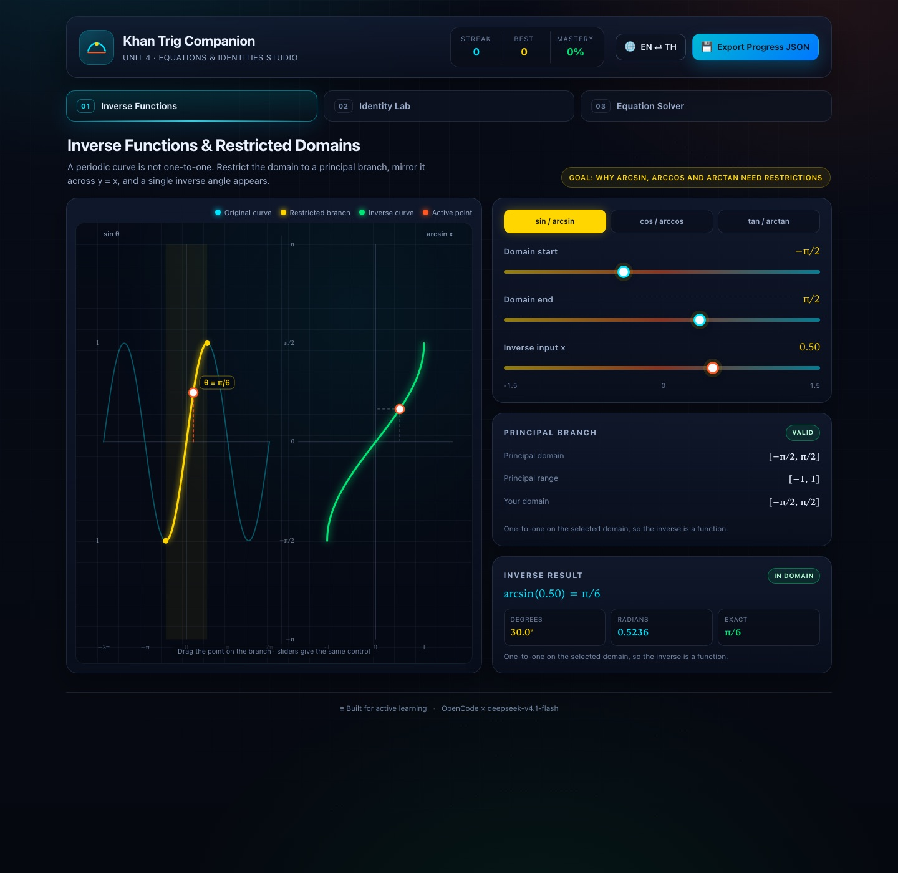

# Khan Trig Companion · Unit 4 Equations & Identities Studio

An interactive, bilingual companion for **Khan Academy Trigonometry, Unit 4: Trigonometric Equations & Identities**. Students discover why inverse functions need restricted domains, build algebraic simplifications one legal step at a time, and solve equations with every solution revealed on the unit circle.

**Version 1.0.0** · [Live demo](https://somphol.github.io/khan-trig-unit4-equations-identities-studio/) · MIT · No build step



## The three studios

| # | Module | What it teaches |
|---|--------|-----------------|
| 01 | **Inverse Functions & Restricted Domains** | Original sine/cosine/tangent curves beside their inverse curves, with draggable principal-branch points, domain sliders and instant valid/undefined badges. |
| 02 | **Pythagorean Identities & Simplification Lab** | Seven expressions, one legal substitution at a time, with immediate feedback and a geometric area model for the three Pythagorean identities. |
| 03 | **Equation Solver** | Basic equations, quadratic-form factoring and identity proofs, with comma-separated answer checking and animated unit-circle intersections. |

## Features

- **Principal branches, visually** — the restricted domain is a gold band on the original curve; the inverse is drawn only when the domain is one-to-one.
- **Undefined states are explicit** — an input outside `[−1, 1]` makes arcsin/arccos undefined; an angle outside the chosen branch is flagged separately.
- **Exact inverse values** — `arcsin(0.5) = π/6`, `arccos(0.5) = π/3` and `arctan(1) = π/4` appear alongside degrees and decimals.
- **Step-by-step algebra** — the identity lab accepts only substitutions that follow from an identity and shows the transformed expression after each correct step.
- **Area-model proof** — squares on the sides of a right triangle are labelled `sin²θ`, `cos²θ`, `1`, `tan²θ`, `sec²θ` and so on.
- **All solutions, not one** — equation answers are checked as a set; `π/6, 5π/6` and decimal equivalents both work.
- **Animated unit circle** — each revealed solution appears as an intersection point with its exact angle label.
- **Bilingual HUD (EN ⇄ TH)** — ฟังก์ชันตรีโกณมิติผกผัน, เอกลักษณ์พิทาโกรัส and คำตอบทั่วไป throughout.
- **Progress persistence** — streak, best streak, correct counts, mode, expression step and completed modules are saved to `localStorage`.
- **Export** — `💾 Export Progress JSON` downloads `khan_trig_unit4_progress.json`.
- **Accessibility** — labelled controls, keyboard tabs, visible focus rings, ARIA live feedback and reduced-motion support.
- **Offline and static** — no frameworks, CDN, fonts to download or network requests at runtime.

## Run locally

No install and no build step.

```bash
git clone https://github.com/somphol/khan-trig-unit4-equations-identities-studio.git
cd khan-trig-unit4-equations-identities-studio
python3 -m http.server 8080
```

Open <http://localhost:8080>. Opening `index.html` directly also works.

## How to use it

1. **Inverse Functions** — choose sin/cos/tan, narrow or widen the domain, drag the point, and test inputs inside and outside the function's range.
2. **Identity Lab** — pick an expression and choose the next legal substitution. The area model updates to the identity that powers the step.
3. **Equation Solver** — choose Basic, Quadratic Form or Identity Proofs, answer, then reveal the animated solution.

## Project structure

```
index.html   HUD, three panels, sliders, practice form and bilingual hooks
style.css    Palette, layout, canvas cards, choices, steps and responsive rules
script.js    State, i18n, inverse branches, identity engine, equation solver, export
state.json   Build record: elapsed time, token usage, credits
AGENTS.md    Operating notes for the next developer or agent
assets/      Documentation screenshot only
```

## Data and privacy

Everything stays in the browser. The only storage is `localStorage["khanTrigUnit4.v1"]` (language, settings, scores, badges). The export button creates a local Blob; nothing is uploaded. Clearing site data resets the studio.

## Verification

Tested in headless Chrome 156 on macOS with zero console errors: principal branches for all three inverse functions, out-of-range and non-one-to-one warnings, point dragging, two-step identity simplification, all three practice modes with correct answers, animated solution points, EN ⇄ TH switching, reload persistence, JSON export and a 390 px mobile viewport with no horizontal overflow.

## Credits

Built in a single session with **[OpenCode](https://opencode.ai)** running **DeepSeek V4.1 Flash** (`opencode-go/deepseek-v4.1-flash`). Exact elapsed time and token consumption are recorded in [`state.json`](state.json).

## Licence

MIT — see [LICENSE](LICENSE).
